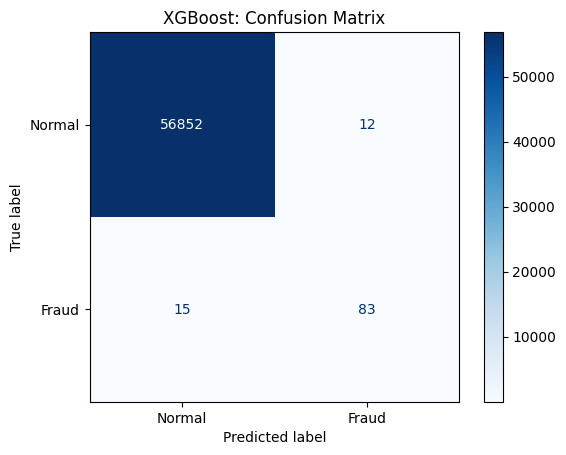
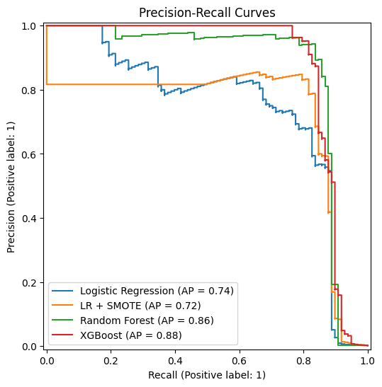
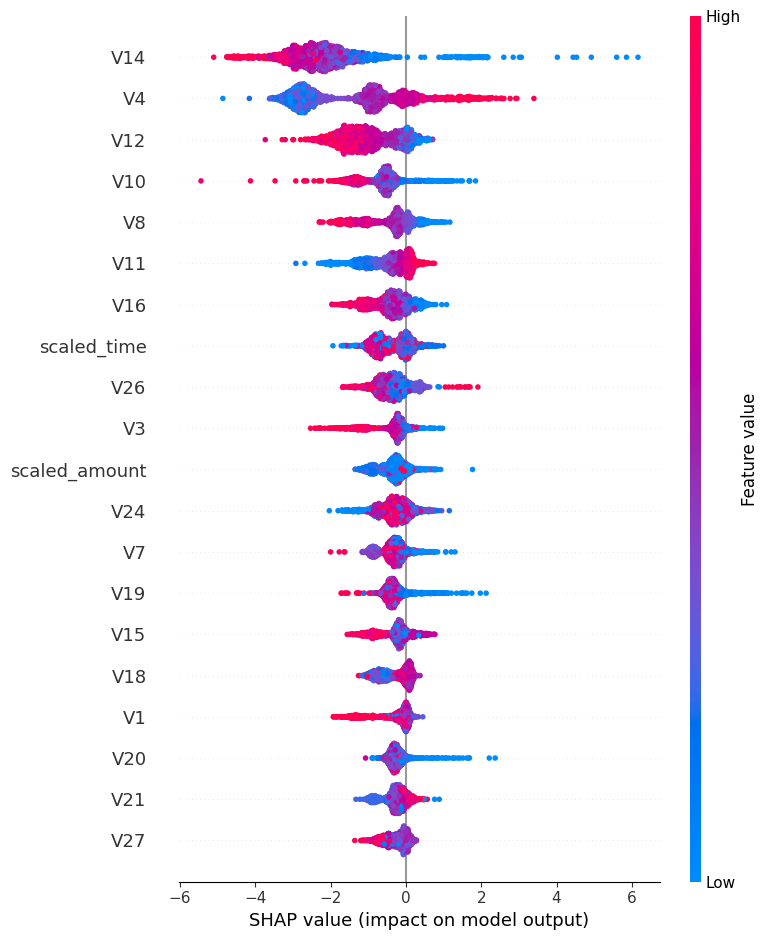
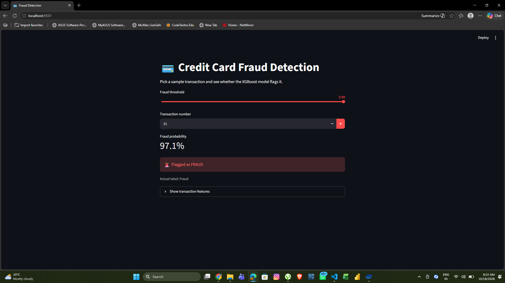
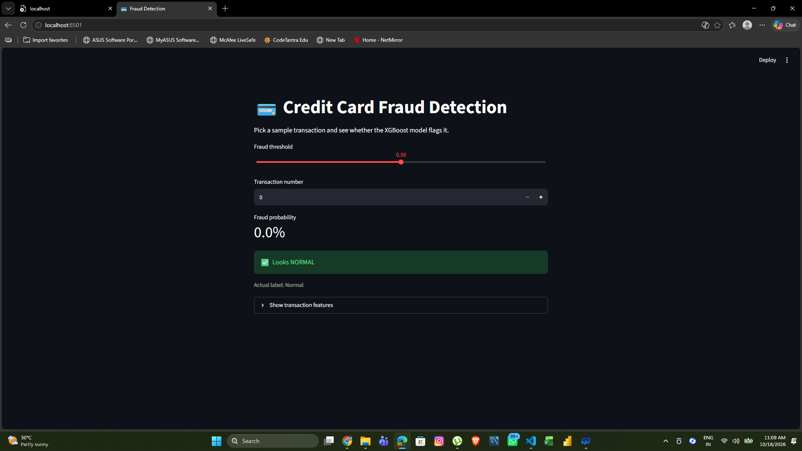

# Credit Card Fraud Detection

Machine learning project to detect fraudulent credit card transactions on a highly imbalanced dataset.

## Dataset
[Credit Card Fraud Detection (Kaggle, ULB)](https://www.kaggle.com/datasets/mlg-ulb/creditcardfraud): 284,807 transactions, of which only 492 (0.17%) are fraud. The dataset is not included in this repo because of its size.

## Approach
1. Exploratory data analysis
2. Scaled `Amount` and `Time` with RobustScaler
3. Stratified 80/20 train-test split
4. Handled class imbalance with SMOTE (training data only) and class weighting
5. Trained Logistic Regression, Logistic Regression + SMOTE, Random Forest and XGBoost
6. Evaluated with precision, recall and PR-AUC rather than accuracy
7. Explained predictions with SHAP and tuned the decision threshold

## Results
| Model | PR-AUC | ROC-AUC |
|---|---|---|
| Logistic Regression | | |
| Logistic Regression + SMOTE | | |
| Random Forest | | |
| XGBoost | | |

Best model: XGBoost, [recall]% recall and [precision]% precision at threshold [t].

## Visuals







## Key insights
- Accuracy is misleading here: predicting "not fraud" every time scores about 99.8%.
- Lowering the threshold catches more fraud but raises false alarms.
- [Top SHAP features] drive the fraud predictions.

## Run the demo
```
pip install -r requirements.txt
streamlit run app.py
```
